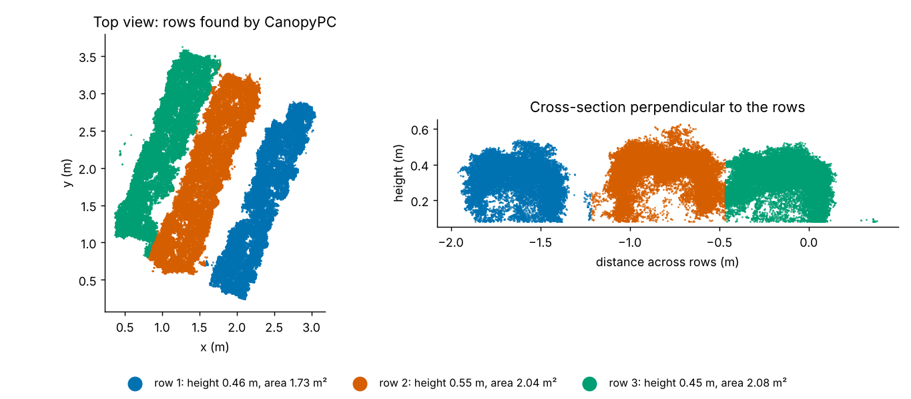

# CanopyPC

English | [中文](README.zh-CN.md)

[](https://github.com/smiler488/CanopyPC/actions/workflows/test.yml) [](LICENSE) 
CanopyPC turns a UAV point cloud of a row-crop plot into a table of row-level canopy traits: plant height, convex-hull volume, projected area and bounding-box dimensions.

I wrote it for field plots reconstructed from cross-circular oblique (CCO) UAV flights, where each plot holds a few rows and I needed the same structural traits for every plot of a trial without hand-measuring them in CloudCompare. The point clouds came from photogrammetry, but any `.ply` with metric coordinates works.

## What it does

1. **Ground removal** with the Cloth Simulation Filter (Zhang et al., 2016).
2. **Levelling**: a RANSAC plane is fitted to the ground points, its normal is rotated onto +Z and the ground is shifted to z = 0, so heights are heights above the soil.
3. **Cleaning**: statistical outlier removal, DBSCAN removal of small clusters, and removal of compact objects such as plot labels. An optional window lets you pick and delete leftovers by hand.
4. **Row segmentation**: points are projected onto the axis perpendicular to the planting direction and split with 1-D K-means. The planting direction can be given, or estimated by scanning angles for the one at which rows and inter-row gaps form the sharpest peaks (more robust than PCA on square plots).
5. **Traits per row**, written to CSV.

| Column | Meaning |
|---|---|
| `num_points` | points in the row |
| `height_max`, `height_min`, `height_mean` | z statistics above the ground plane |
| `plant_height` | `height_max - height_min` |
| `convex_hull_volume` | volume of the convex hull after the row base is closed at its lowest point |
| `minimal_cube_volume` | cube on the longest edge of the oriented bounding box |
| `volume_ratio` | `convex_hull_volume / minimal_cube_volume`, a compactness index |
| `row_projected_area` | area of the 2-D convex hull of the row in the XY plane |
| `canopy_area_ratio` | `row_projected_area * n_rows / plot projected area` |
| `obb_extent_x/y/z` | oriented bounding box edge lengths |

Units follow the input cloud.

## Installation

Python 3.9 to 3.12 (Open3D wheels usually lag behind new Python releases).

```bash
git clone https://github.com/smiler488/CanopyPC.git
cd CanopyPC
pip install -r requirements.txt
```

The `CSF` module comes from the `cloth-simulation-filter` package on PyPI. The package called `CSF` on PyPI is unrelated.

## Usage

Command line:

```bash
python process_point_cloud.py plot.ply --rows 3 --direction 1 2.3 -o plot_traits.csv
```

Useful flags:

- `--no-vis` runs without any window (batch jobs, servers).
- `--no-manual` keeps the viewers but skips the manual clean-up step.
- `--cloth-resolution` sets the CSF grid size. 0.1 m worked for my plots; use a larger value on rough or sloping ground.

From Python:

```python
from process_point_cloud import process_point_cloud, write_results_csv

res = process_point_cloud("plot.ply", planting_direction=[1, 2.3], n_rows=3,
                          visualize=False, interactive=False)
write_results_csv(res["all_results"], "plot_traits.csv")
```

`scripts/quick_row_split.py` is an earlier, cruder version (percentile ground cut, equal-width rows). I keep it for a fast first look at a new reconstruction.

## Sample data

`data/sample/` holds the canopy of one plot with three rows, split into three files (`canopy_row_*.ply`) by the equal-width cut of `scripts/quick_row_split.py`, and the CSF cloth nodes of that plot (`cloth_nodes.txt`). The equal-width cut does not follow the rows, so merge the files and let CanopyPC find the rows:

```python
import numpy as np
import open3d as o3d
from process_point_cloud import segment_major_rows, row_traits, projected_area_xy

pts = np.vstack([np.asarray(o3d.io.read_point_cloud(f"data/sample/canopy_row_{i}.ply").points)
                 for i in (1, 2, 3)])
pts -= pts.min(axis=0)
canopy = o3d.geometry.PointCloud(o3d.utility.Vector3dVector(pts[pts[:, 2] > 0.08]))
rows, _ = segment_major_rows(canopy, n_rows=3)
plot_area = projected_area_xy(np.asarray(canopy.points))
for i, row in rows:
    print(row_traits(i, row, plot_area, n_rows=3)[0])
```



On this plot the three rows are 0.45–0.55 m tall with 1.7–2.1 m² projected area each.

## Notes and limits

- K-means assumes rows of similar width with visible gaps. Once canopies close between rows the split gets less reliable, so check the row view before using the numbers.
- Convex-hull volume overestimates real canopy volume, especially in open canopies. I use it as a relative index between treatments, not as an absolute biomass proxy. Alpha shapes or voxel counts are better for absolute values.
- The label filter drops any compact cluster with a hull surface area below 0.2 (cloud units²). Lower it for small plants.

## Changes in this revision

- Projected area was about twice the real value; fixed.
- The planting direction was estimated by PCA, which follows the plot outline rather than the rows and cut across rows on near-square plots (the sample plot is one). It is now estimated from the row/gap pattern itself.
- Clouds were flipped upside down when the fitted ground normal pointed down; fixed.
- `canopy_area_ratio` now uses the actual number of rows instead of a fixed 3.
- Command line interface, CSV export and switches to turn off the viewers.
- The wrong `CSF` dependency is replaced by `cloth-simulation-filter`.

## Citation

Please cite with the metadata in [`CITATION.cff`](CITATION.cff), or:

```bibtex
@software{deng_canopypc,
  author = {Deng, Liangchao},
  title  = {CanopyPC: row-level canopy traits from UAV point clouds},
  year   = {2025},
  url    = {https://github.com/smiler488/CanopyPC}
}
```

CSF: Zhang, W. et al. (2016). An easy-to-use airborne LiDAR data filtering method based on cloth simulation. *Remote Sensing*, 8(6), 501.

## License

MIT, see [LICENSE](LICENSE). Liangchao Deng (邓良超).
